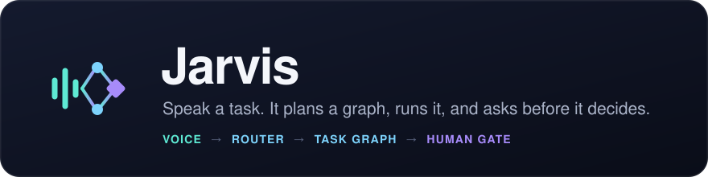
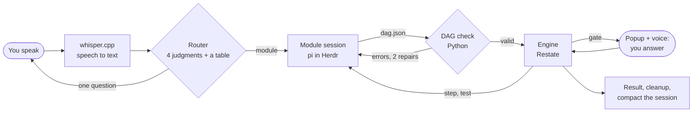

<p align="center">
  
</p>

<p align="center">
  
  
  
  
  <a href="LICENSE"></a>
</p>

**Jarvis is a voice assistant that runs on your Mac.** You speak a request. Jarvis writes a plan as a small graph, checks the plan in code, runs it one step at a time in a visible agent session, and stops to ask you before each decision that matters.

- **Fixed steps.** Each task is a graph (a DAG) in a `dag.json` file. Python checks the graph before a step runs.
- **AI inside.** An agent session does the work of each step: it drives the browser, writes code, reads pages.
- **A human when needed.** A `gate` step opens a popup and speaks a question. The run waits until you answer.

## Contents

[How it works](#how-it-works) · [Quick start](#quick-start) · [What you need](#what-you-need) · [Use it](#use-it) · [Modules](#modules) · [The task graph](#the-task-graph) · [Settings](#settings) · [Set up with an AI agent](#set-up-with-an-ai-agent) · [File map](#file-map) · [Problems](#problems) · [Status and limits](#status-and-limits) · [License](#license)

## How it works



1. **Listen.** Press Option+Space and speak. `whisper.cpp` changes the speech to text on your Mac. No audio leaves the Mac.
2. **Route.** Jarvis sends the text and the module list to [TypeSafe](https://docs.typesafe.ai) (the Jev model). Jev answers four questions with probabilities: which module, does a module fit, is the detail enough, is the task long. A small table in Python then decides. The result is one module, or one question for you.
3. **Plan.** Each module has one `pi` session that stays alive in [Herdr](#what-you-need). The session writes the plan to `dag.json`.
4. **Check.** Python checks the plan with a topological sort (Kahn's algorithm). It refuses a loop, a missing test and a missing gate. The session gets the errors and can repair the plan two times.
5. **Run.** The engine is a [Restate](https://restate.dev) workflow. It sends each node to the session, in order, and stores each result. If the engine stops and starts again, a step that is done does not run a second time.
6. **Ask.** At a gate, the engine opens a macOS popup and speaks the question. You answer in the popup or by voice. "No" ends the run.
7. **Go back after a failure.** If a `test` node fails, the engine runs the `undo` of each step on the way back, then tries again from an earlier node. After two returns it asks you: retry, skip or stop.
8. **Finish.** Jarvis speaks the result, deletes the temporary files and compacts the session context.

## Quick start

```sh
git clone https://github.com/arjunprakash027/jarvis.git
cd jarvis
scripts/install.sh
```

The script installs the missing tools with Homebrew, downloads the speech model (about 140 MB) and runs `uv sync`. It is safe to run again. `scripts/install.sh --check` reports what is missing and changes nothing.

Then do the three steps that the script cannot do:

1. Put your TypeSafe key in `.env` (git ignores this file):

   ```sh
   TYPESAFE_API_KEY=your-key
   ```

2. Run `pi` one time and sign in to a model provider. Then set a model that your `pi` can use in each `modules/<name>/module.toml`.
3. Start Jarvis:

   ```sh
   uv run jarvis up
   ```

Wait for `Jarvis ready`. Press **Option+Space**, say a request, and press **Option+Space** again.

To try Jarvis with no microphone, type your requests:

```sh
uv run jarvis up --text
```

## What you need

| Part | Why | Installed by the script |
| --- | --- | --- |
| A Mac (tested on an M1, 8 GB) | Jarvis uses `say`, `osascript` and AppKit. | |
| [Homebrew](https://brew.sh) | Installs the tools below. | No |
| [uv](https://docs.astral.sh/uv/) | Python 3.11+ and the package. | Yes |
| [whisper.cpp](https://github.com/ggerganov/whisper.cpp) and `ggml-base.en.bin` | Local speech to text. | Yes |
| [Restate](https://restate.dev) (`restate-server`, `restate`) | The task engine. | Yes |
| [pi](https://pi.dev) (`pi-coding-agent`) | The agent in each module session. | Yes |
| Herdr Core (`hc`) | Keeps each agent session alive in a terminal that you can open. How you install it depends on your setup. The script only checks for it. | No |
| Xcode command line tools (`swiftc`) | Builds the progress window on first use. Optional. | No |
| A TypeSafe key | The router. | No |
| A model provider in `pi` | The model for each module session. | No |

The `shopping` module also needs [ego-browser](modules/shopping/skills/ego-browser/SKILL.md), with your shop accounts signed in. Its calendar step needs the Composio extension for `pi`.

## Use it

| You do | Jarvis does |
| --- | --- |
| Press Option+Space, speak, press Option+Space | A pill with a waveform shows at the top of the screen. It shows what Jarvis heard, then becomes the progress window for that task. |
| Press Enter in the terminal, speak, press Enter | The same, without the hotkey. |
| Say "yes", "no", or the number or name of a choice | Answers the oldest open gate. The answer does not go through the router. |
| Type in the popup | Gives a longer answer to a gate. |
| Press Esc while the pill shows | Cancels the recording. |
| Press Ctrl-C in the terminal | Stops input. Jarvis waits for the active tasks to end. |

Commands:

| Command | What it does |
| --- | --- |
| `uv run jarvis up` | Starts Jarvis with voice. |
| `uv run jarvis up --text` | Starts Jarvis with typed input. |
| `uv run jarvis modules` | Lists each module with its description. |
| `uv run jarvis logs` | Shows the last 50 log lines and follows the log. |
| `uv run jarvis dag check <path>` | Checks one `dag.json`. |

Each step prints one line. This is the shape of a run (the values are an example):

```text
14:02:11 heard    "what does a PS5 cost on Argos" (1.2 s)
14:02:12 jev      probs: [shopping: 0.97, builder: 0.02, sys-widget: 0.01] · fits: 0.98 · detail: 0.93 · long: 0.08
14:02:12 route    shopping (0.97) · detail ok
14:02:12 session  jarvis-shopping: reused (antigravity/gemini-3-8-flash:high)
14:02:41 plan     dag.json written: 4 nodes
14:02:41 plan     check OK
14:02:41 task     shopping: submitted to Restate
14:03:30 node     find: ok · "PS5 from GBP 519.99"
14:03:52 node     check: ok · "Price read from the product page"
14:03:52 gate     pay: waiting for you
14:04:05 gate     pay: no
14:04:09 done     shopping: declined in 1 m
```

You can watch each agent work. `hc ls` lists the sessions. `hc attach jarvis-shopping` opens one.

Run only one `jarvis up` at a time. [docs/run.md](docs/run.md) has the full run notes.

## Modules

A module teaches Jarvis one type of task. It is one folder in `modules/`. To add a type of task, add a folder. No other code changes.

| Module | What it does | Gate it must have |
| --- | --- | --- |
| `shopping` | Buys or prices things online: groceries on Tesco, products on Amazon, cinema tickets. It stops before payment. | `pay` |
| `builder` | Builds new software from a request, most often a new Jarvis module. It writes a spec first. | `approve-plan` |
| `sys-widget` | Shows the RAM and SSD space in use. | none |

```
modules/<name>/
  module.toml    settings: the router, the engine and the session read this file
  CLAUDE.md      instructions for the session
  skills/        skills for this module's session only
  extensions/    pi extensions for this module's session only
  tasks/<id>/    files for each run (git ignores this folder)
```

Each module extends one base, `modules/_base/`. The base gives each module four rules that it cannot turn off:

1. The engine owns each gate. A session cannot skip or answer a gate.
2. Each task has a `dag.json` plan.
3. Each plan has one `test` node or more.
4. Jarvis compacts the session when a run ends.

To add a module:

```sh
cp -R modules/_example modules/my-module
# edit modules/my-module/module.toml and CLAUDE.md
uv run jarvis modules
```

A running `jarvis up` finds a new module on the next request. [docs/module-contract.md](docs/module-contract.md) gives each field. Or ask Jarvis: "build me a module that …".

## The task graph

```json
{
  "task": "Add milk, eggs and bread to my Tesco basket",
  "nodes": [
    {"id": "search", "type": "step", "do": "Find each item", "needs": []},
    {"id": "basket", "type": "step", "do": "Add the items to the basket", "needs": ["search"],
     "undo": "Remove the items from the basket"},
    {"id": "verify", "type": "test", "do": "Confirm the basket holds the 3 items", "needs": ["basket"],
     "on_fail": "search"},
    {"id": "pay", "type": "gate", "do": "Tesco basket, total is 6.40. Do I pay?", "needs": ["verify"]}
  ]
}
```

| Node type | What the engine does |
| --- | --- |
| `step` | Sends the instruction to the session. After a failure it tries one more time, then asks you. |
| `test` | Sends the check to the session. After a failure it undoes steps and goes back to the `on_fail` node. |
| `gate` | Asks you and waits. |

- `needs` links go forward only. This makes the plan a graph with no loop.
- `on_fail` links go back, and only from a `test` node. A step that passed its test does not run again.
- Each node gets the results of the nodes it needs. Thus a gate can show the real total.

[docs/dag-format.md](docs/dag-format.md) gives the full format.

## Settings

| Variable | Default | What it does |
| --- | --- | --- |
| `TYPESAFE_API_KEY` | none | The key for the router. Jarvis reads the environment first, then `.env`. |
| `JARVIS_HOTKEY` | `option+space` | The hotkey, for example `cmd+shift+j`. |
| `JARVIS_NO_HUD` | not set | `1` turns off the progress window and the hotkey. |
| `JARVIS_MODULES_DIR` | `modules/` | A different module folder. |
| `JARVIS_LOG` | `~/.local/share/jarvis/jarvis.log` | The log file. |
| `JARVIS_RESTATE_ADMIN` | `http://127.0.0.1:9070` | An external Restate admin address. |
| `JARVIS_RESTATE_INGRESS` | `http://127.0.0.1:8080` | An external Restate ingress address. |

Jarvis uses ports 9070 and 8080 (Restate) and 9080 (its own executor).

## Set up with an AI agent

The repository has two [Agent Skills](https://agentskills.io) and an [AGENTS.md](AGENTS.md). A coding agent can read them and do the setup with you.

| Skill | What it teaches the agent |
| --- | --- |
| [`skills/jarvis-setup`](skills/jarvis-setup/SKILL.md) | What Jarvis is, how to install and check it, and how to correct each common failure. |
| [`skills/jarvis-module`](skills/jarvis-module/SKILL.md) | How to add or change a module. |

Open the repository in your agent (Claude Code, pi, Codex) and paste this:

```text
Read skills/jarvis-setup/SKILL.md and set up Jarvis on this Mac.
Run scripts/install.sh --check first and tell me what is missing.
Ask me for each key and each sign-in. Do not read .env.
```

To make the skills available in each project, copy them to the skills folder of your agent, for example `cp -R skills/jarvis-* ~/.claude/skills/`.

## File map

| Path | What it does | Connects to |
| --- | --- | --- |
| `scripts/install.sh` | Installs and checks each part that Jarvis needs. | `pyproject.toml`, `docs/voice.md` |
| `skills/jarvis-setup/`, `skills/jarvis-module/` | Agent Skills: set up Jarvis, add a module. | `scripts/install.sh`, `modules/_example/` |
| `AGENTS.md` | Short rules for a coding agent that works in this repository. | `skills/` |
| `pyproject.toml` | Defines the `jarvis` package and the `jarvis` command. | `src/jarvis/cli.py` |
| `src/jarvis/cli.py` | The `jarvis` command: `up`, `modules`, `logs`, `dag check`. | `main.py`, `modules.py`, `dag.py`, `log.py` |
| `src/jarvis/main.py` | `jarvis up`: listens, routes, plans, submits a task, sends each gate answer to its gate. | Each file in `src/jarvis/` |
| `src/jarvis/voice.py` | Records the microphone, runs `whisper-cli`, speaks with `say`. | `main.py`, `gate.py` |
| `src/jarvis/router.py`, `router_questions.py` | The four questions for Jev and the decision table. | `modules.py`, `main.py` |
| `src/jarvis/modules.py` | The module base and the loader for `modules/`. | `cli.py`, `router.py`, `harness.py` |
| `src/jarvis/harness.py` | The one `pi` session of each module in Herdr: start, send, read, compact, clean. | `engine.py`, `main.py` |
| `src/jarvis/dag.py` | The DAG check. | `main.py`, `engine.py`, `cli.py` |
| `src/jarvis/engine.py` | The Restate workflow that runs a DAG node by node, with undo and returns. | `dag.py`, `gate.py`, `harness.py` |
| `src/jarvis/gate.py` | The gate popup, the spoken question and the answer. | `engine.py`, `main.py` |
| `src/jarvis/log.py` | One line for each event, in the terminal and in the log file. | Each file in `src/jarvis/` |
| `src/jarvis/hud.py`, `hud_app.swift` | The hotkey pill and the progress window. Compiled to `bin/jarvis-hud` on first use. | `main.py`, `log.py` |
| `modules/_base/` | The rules and the extension that each module session loads. | `modules.py`, `harness.py` |
| `modules/_example/` | The template for a new module. | `modules.py` |
| `modules/shopping/`, `modules/builder/`, `modules/sys-widget/` | The three modules. | `modules/_base/` |
| `docs/` | Run notes, the DAG format, the module contract, the voice and Restate measurements, the test record. | |
| `docs/assets/` | The icon and the banner (SVG). | `README.md` |
| `tests/` | The tests. Run them with `uv run pytest -q`. | `src/jarvis/` |

## Problems

| Sign | Correction |
| --- | --- |
| `TYPESAFE_API_KEY is not set` | Put the key in `.env`. |
| `Missing whisper model` | Run `scripts/install.sh`. |
| `Restate registration failed` | A different process uses port 9070, 8080 or 9080, or a second `jarvis up` runs. Stop it. |
| `jarvis-<name> is blocked` | The session shows a dialog. Open it with `hc attach jarvis-<name>` and answer. |
| No pill and no window | Install the Xcode command line tools (`xcode-select --install`). Make sure that `JARVIS_NO_HUD` is not `1`. |
| The microphone records nothing | Give your terminal app microphone access in System Settings > Privacy & Security > Microphone. |
| The router asks "Is this A or B?" | Two module descriptions are too near. Make each `description` more specific. |

`uv run jarvis logs` shows what happened. The setup skill lists more cases.

## Status and limits

- Jarvis is an MVP. It was built and tested on one M1 Mac. [docs/test-run.md](docs/test-run.md) records the test by voice, with what passed and what did not.
- macOS only. English speech only.
- A purchase stops before payment. Jarvis does not open a card-entry page.
- Jarvis has no memory across modules. Each module session keeps a compact summary of its own earlier runs.
- No wake word. You start each request with the hotkey or Enter.

## License

[MIT](LICENSE).

## More to read

- [docs/run.md](docs/run.md): run notes
- [docs/dag-format.md](docs/dag-format.md): the task graph
- [docs/module-contract.md](docs/module-contract.md): the module contract
- [docs/voice.md](docs/voice.md): the speech model and its measured time
- [docs/restate.md](docs/restate.md): the Restate proof
- [docs/compaction.md](docs/compaction.md): how compaction was measured
